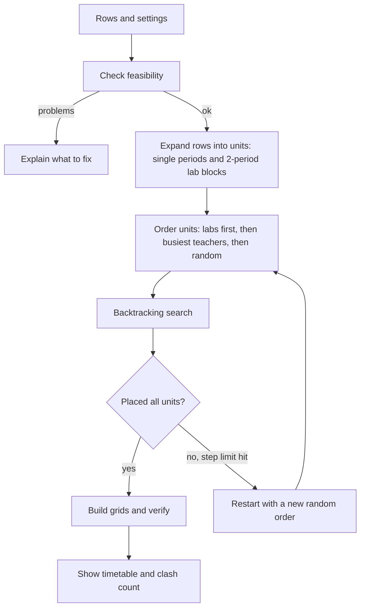

# Slotly

### Clash-free college timetables, generated in seconds.

Add your subjects and teachers, set your rules, and get a verified timetable for every section and every teacher. It runs entirely in your browser.


[**Live Demo**](https://YOUR-USERNAME.github.io/slotly) · [**Report a Bug**](../../issues) · [**Request a Feature**](../../issues)

</div>

---

## Table of Contents

[Overview](#overview) · [Features](#features) · [How to Use](#how-to-use) · [The Rules the Solver Follows](#the-rules-the-solver-follows) · [How the Solver Works](#how-the-solver-works) · [Input Validation](#input-validation) · [Data Model](#data-model) · [Customize](#customize) · [Run and Deploy](#run-and-deploy) · [Testing](#testing) · [Limitations](#limitations) · [Roadmap](#roadmap)

## Overview

Building a college timetable by hand means juggling teachers who handle several sections, labs that need two periods in a row and a lunch break that nothing may cross. One missed overlap and the whole week has to be redone.

Slotly turns that into a constraint problem. You describe the subjects, and it searches for a placement of every period that breaks none of the rules, then checks its own answer before showing it.

The site has a landing page and the generator on one page, with a powder blue and white design, light and dark themes, and a layout that works on phones.

## Features

| | Feature | Details |
|---|---|---|
| 🧩 | **Automatic clash solving** | No teacher is in two places at once, and no section has two subjects in one slot |
| 👥 | **Shared teachers** | One teacher can handle many sections |
| 🧪 | **Lab double periods** | Labs are placed as back-to-back blocks that never cross the lunch break |
| ⚖️ | **Balanced weeks** | Subjects are spread across days, with a cap on repeats per day |
| 🍽️ | **Lunch break aware** | Choose where lunch falls and how long it is. Period times adjust automatically |
| 🎯 | **Per-teacher daily limit** | Stops any teacher from being overloaded on one day |
| ✅ | **Verified result** | The timetable is re-checked after solving and the clash count is shown |
| 🔁 | **Generate another** | Get a different valid timetable with one click |
| 👤 | **Teacher view** | See any teacher's whole week across all sections |
| 📊 | **Workload table** | Periods per week, sections and free periods for each teacher |
| 🖨️ | **Print all sections** | One page per section, with colours preserved |
| 📋 | **Copy as CSV** | Paste any timetable straight into Excel or Google Sheets |
| 💾 | **Autosave** | Your setup is saved in the browser |
| 🌗 | **Light and dark themes** | Follows your device, with a manual toggle |

## How to Use

1. **Setup**: choose working days (5 or 6), periods per day, where lunch falls, the start time, period length, lunch length and the maximum periods per teacher per day. List your sections, for example `CSE-A, CSE-B`.
2. **Add subjects**: for each subject enter the name, the teacher, the section (or **All sections**), periods per week, and the type (Theory or Lab).
3. **Generate**: press **Generate timetable**. Use the tabs to flip between sections, or the teacher selector to see one teacher's week.
4. **Export**: print all sections, or copy the current view as CSV.

Press **Load sample** to start from a ready-made two-section example.

## The Rules the Solver Follows

| Rule | Type |
|---|---|
| A section has at most one subject in any slot | Hard |
| A teacher is in at most one place in any slot, across all sections | Hard |
| Every subject gets exactly its periods per week | Hard |
| Lab periods are placed as 2-period blocks, with a single leftover period if the count is odd | Hard |
| A lab block never spans the lunch break | Hard |
| A teacher teaches no more than the daily limit | Hard |
| A theory subject has at most `ceil(periods ÷ days)` periods on any one day | Hard |
| A lab has at most one block per day | Hard |
| Prefer lighter days for each section, to spread the load | Soft |
| Avoid repeating the same subject on a day | Soft |
| Prefer labs after lunch | Soft |

## How the Solver Works



1. **Expand**: each row becomes one unit per period, or one unit per two-period block for labs. A row set to *All sections* becomes one row per section.
2. **Order**: the hardest units go first, meaning lab blocks and the teachers with the most periods. Ties are broken randomly, so every run can find a different timetable.
3. **Search**: for each unit the solver lists every legal slot, scores them (lighter days first, no same-subject repeats, labs after lunch, plus a little randomness), and tries them best-first. If a later unit has nowhere to go, it undoes the last choice and tries the next one.
4. **Restart**: each attempt is limited to 25,000 steps. If it fails, the solver restarts with a new order, up to 500 attempts or 2.5 seconds.
5. **Verify**: the result is rebuilt from scratch and checked for teacher clashes and section clashes. The count is shown as **Clashes** in the results.

## Input Validation

Before solving, Slotly catches problems that make a timetable impossible and says exactly what to fix:

| Message | Meaning |
|---|---|
| `CSE-A needs 49 periods but only has 35 slots a week` | A section has more periods than the week can hold |
| `Dr. Meera has 52 periods, above the daily limit of 6 over 5 days` | A teacher cannot fit under the daily cap |
| `Row 3: a lab can have at most 10 periods` | A lab is limited to one block per day |
| `Row 1: enter a teacher` | A required field is empty |
| `The lunch break must come before the last period` | Break position is invalid |

If the solver runs out of attempts, it suggests the usual fixes: fewer periods for the busiest teacher, another teacher, a higher daily limit or an extra period per day.

## Data Model

Everything is saved in one object under the browser key `slotly-v1`:

```json
{
  "cfg": { "days": 5, "periods": 7, "breakAfter": 4, "start": "09:00", "len": 50, "brk": 40, "tMax": 6 },
  "secs": "CSE-A, CSE-B",
  "rows": [
    { "subj": "Data Structures", "teacher": "Dr. Meera", "sec": "*", "n": 4, "type": "Theory" }
  ]
}
```

`sec` is `"*"` for all sections, or a single section name. The theme is stored under `slotly-theme`.

## Customize

| What | Where |
|---|---|
| **Colours** | The `:root` block: `--pb` (powder blue), `--ac` (accent), `--ink`, `--sky` |
| **Subject colours** | The `PAL` array near the top of the script |
| **Sample data** | The `SAMPLE` object |
| **Search effort** | `25000` steps per attempt, `500` attempts and `2500` ms in `solve()` |
| **Soft preferences** | The score line inside `rec()`, such as the weight that spreads days or favours afternoon labs |

## Run and Deploy

```bash
git clone https://github.com/YOUR-USERNAME/slotly.git
cd slotly
open index.html          # or: npx serve .
```

No installs and no build step.

| Platform | Steps |
|---|---|
| **GitHub Pages** | Settings → Pages → Deploy from `main` |
| **Netlify** | Drag and drop the folder |
| **Vercel** | Import the repository |

## Testing

The solver was checked with an independent verifier that rebuilds the schedule from the raw placements and tests every hard rule. These cases all passed with zero clashes:

| Case | Result |
|---|---|
| Sample: 2 sections, 8 subjects, shared teachers | Solved in under 10 ms |
| 4 sections, 6-day week, the same shared teachers | Solved in about 30 ms |
| 3 sections with an extra subject for a busy teacher | Solved in under 10 ms |
| A section with more periods than slots | Rejected with a clear message |
| A row with a missing teacher | Rejected with a clear message |

Manual checklist for the interface:

- [ ] Loading the sample and generating shows 0 clashes
- [ ] Section tabs and the teacher view show the right data
- [ ] Lab blocks are never split by the lunch break
- [ ] Changing the lunch period moves the break row and the times
- [ ] Generate another produces a different valid timetable
- [ ] Print shows one section per page with colours
- [ ] Copy CSV pastes correctly into a spreadsheet
- [ ] Refreshing keeps your setup

## Limitations

- **Feasible, not optimal.** It finds a valid timetable, not the best possible one by every preference.
- **No rooms.** Classroom and lab availability are not modelled yet.
- **No teacher availability slots.** A teacher is free in every slot unless the daily limit says otherwise.
- **No elective groups or split batches.** Each subject belongs to a whole section.
- **Very tight timetables** can need many attempts, or may time out. The tool tells you when this happens.

## Roadmap

- [x] Multiple sections with shared teachers
- [x] Lab blocks and a lunch break
- [x] Teacher view, workload table and printing
- [x] Verified clash count
- [ ] Rooms and lab capacity
- [ ] Teacher unavailable slots and preferred times
- [ ] Elective groups and split lab batches
- [ ] Drag and drop manual edits with live clash warnings
- [ ] Download as PDF and Excel
- [ ] Save and compare several timetables

## Contributing

1. Fork the repository
2. Create a branch: `git checkout -b feature/your-idea`
3. Commit: `git commit -m "Add your idea"`
4. Push and open a pull request

## Author

**S.S. Manikanda Prabu**, B.Tech CSE, SRM Institute of Science and Technology, Ramapuram

[GitHub](https://github.com/YOUR-USERNAME) · [LinkedIn](https://linkedin.com/in/YOUR-PROFILE)

## License

Released under the MIT License.

